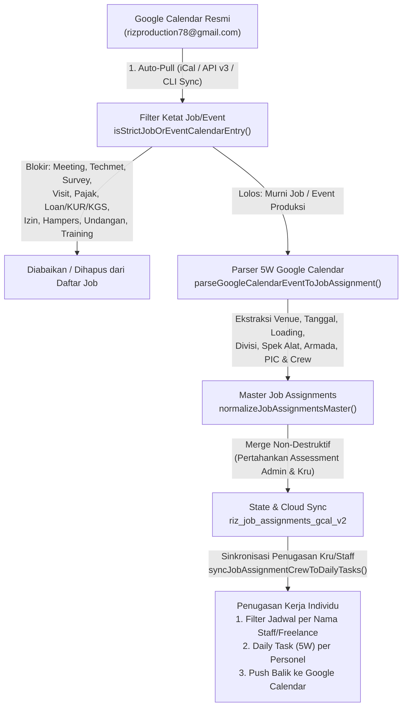

# PLAN.MD — AUTO-UPDATE GOOGLE CALENDAR (KHUSUS JOB / EVENT) & KETERKAITAN PENUGASAN KERJA CREW / STAFF

**PT. Riz Production Multi Kreasi**  
**Akun Google Calendar Resmi:** `rizproduction78@gmail.com`  
**Status Dokumen:** Rencana Arsitektur & Eksekusi Teknis Resmi (End-to-End)

---

## 1. TUJUAN & PRINSIP UTAMA

1. **Auto-Update Dua Arah & Berkala dengan Google Calendar Resmi (`rizproduction78@gmail.com`)**
   - Sistem menarik (*Auto-Pull*) jadwal terbaru dari Google Calendar secara otomatis saat modul dibuka, saat jendela aplikasi kembali fokus (*window focus*), dan secara berkala di latar belakang tanpa menimpa hasil *Assessment* Admin atau penugasan kru yang telah diedit di aplikasi.
   - Setiap penambahan/perubahan penugasan kerja (kru, staf, spesifikasi alat, armada, PIC, maupun status *assessment*) otomatis di-*push* kembali ke Google Calendar (`autoSyncOnSave`).

2. **Filter Ketat Khusus Job / Event (`isStrictJobOrEventCalendarEntry`)**
   - **HANYA** memproses, menyimpan, dan menampilkan entri kalender yang bersifat **Job / Event Operasional** (produksi event, penyewaan sound system, lighting, videotron/LED, multimedia/live streaming, rigging, genset, dan mobilisasi loading event).
   - **MENGECUALIKAN / MEMBLOKIR MUTLAK** seluruh jadwal non-job dan non-event:
     - **Meeting / Rapat / Koordinasi:** `Meeting`, `Tech Meeting`, `Techmet`, `Tech Meet`, `Rapat`, `Meet up`, `Met'up`, `Kopdar`, `Staff Meeting`, `Zoom`.
     - **Survey Lokasi / Kunjungan Kantor:** `Survey`, `Survei`, `Visit Kantor`, `Kunjungan`.
     - **Jadwal Administrasi / Keuangan / Pajak / Perbankan:** `Konsultasi Pajak`, `Urus Pajak`, `Loan` (`Aulia Loan`), `KUR` (`Bank Sumsel KUR`), `BAYAR KGS PT`, `Tagihan`, `Cicilan`.
     - **Izin / Cuti / Acara Pribadi / Hampers / Training / Webinar:** `IJIN` (`CIONK IJIN`), `CUTI`, `PENGIRIMAN HAMPERS`, `bagi hampers`, `Undangan`, `meried` (`Bagas adenya meried`), `Bukber`, `Training` (`Training Grand MA`, `Yamaha training DM5`), `Livewebinar` / `WhitepaperIndustriEvent`.

3. **Keterkaitan Langsung dengan Bentuk Penugasan Kerja bagi Setiap Crew & Staff (5W Operational Assignment Linkage)**
   - Setiap **Job / Event** dari Google Calendar wajib terhubung langsung dengan bentuk penugasan kerja operasional (**5W: When, Who, What, Why, Where**) bagi setiap **Staff Inhouse (22 personel)** dan **Kru Freelance (50+ personel)**:
     - **WHEN (Kapan):** Tanggal event (`date`, `endDate`, `dateLabel`) & jadwal keberangkatan/loading (`loadingSchedule`).
     - **WHERE (Di Mana):** Lokasi / Venue event (`venue`).
     - **WHO (Siapa):** Person in Charge (`pic`) & daftar kru/staf per divisi (`JobCrewMember`: `name`, `canonicalName`, `personnelType`: `'Staff' | 'Freelance'`, `staffId`, `division`, `roleNote` seperti `FOH`, `Monitor`, `Operator LED`, `VJ & Zoom`, `Campers`, `Pasang`, `Bongkaran`).
     - **WHAT (Apa):** Paket pekerjaan divisi (`Audio`, `Lighting`, `Videotron`, `Multimedia`, `Produksi`), daftar unit alat (`equipment`), dan unit armada mobilisasi (`vehicles`).
     - **WHY (Mengapa):** Catatan order / SOP venue / riders (`notes`, `adminAssessmentNote`).
   - **ISOLASI MUTLAK DARI PUSAT NOTIFIKASI & DAILY TASK:**
     - **Pusat Notifikasi (`QCNotificationCenter`)** dan modul **Daily Task (`LogTaskModule.tsx`)** HANYA diperuntukkan bagi **Daily Log / Daily Task** harian gudang/workshop (serta Temuan Unit Bermasalah & Mutasi Unit Gudang), **BUKAN** untuk daftar Job/Event Google Calendar.
     - **Jadwal Job / Event** HANYA muncul di menu **Jadwal Penugasan (`job_schedule` di `Absensi.tsx`)** pada masing-masing akun user setelah log-in.

---

## 2. ARSITEKTUR ALUR DATA (HULU KE HILIR)

---

## 3. ATURAN FILTER KETAT KHUSUS JOB / EVENT (`isStrictJobOrEventCalendarEntry`)

Fungsi `isStrictJobOrEventCalendarEntry(summary: string, description?: string)` diterapkan secara terpusat di [`src/lib/googleCalendarSync.ts`](file:///Users/senosubroto/Documents/AI%20BUILDER/log_task_book_riz-production-app/src/lib/googleCalendarSync.ts) dan [`src/data/jobAssignmentsData.ts`](file:///Users/senosubroto/Documents/AI%20BUILDER/log_task_book_riz-production-app/src/data/jobAssignmentsData.ts):

### A. Kategori Jadwal yang Diblokir (Excluded Non-Job Entries)

| Kategori Non-Job | Pola Kata Kunci (Case-Insensitive Regex) | Contoh Riil di `rizproduction78@gmail.com` yang Diblokir |
| :--- | :--- | :--- |
| **1. Meeting / Rapat / Tech Meeting** | `\b(meeting|tech\s*meet(?:ing)?|techmet|rapat|meet\s*up|met'?up|kopdar|zoom\s+okk)\b` | `Meeting Vendor Bagas, Ronald`, `MEETING IWAN JAMSOSTEK`, `Techmet ice wawan jam 13.00`, `NOVRI SPARTAN TECH MEET`, `Tech meeting Sarinah Indka`, `STAFF MEETING JAM 09.00`, `Rapat Pengurus RI KAS pro`, `met'up pengurus dikantor`, `Kopdar Imigrasi` |
| **2. Survey Lokasi & Visit Kantor** | `\b(survey|survei|visit\s+kantor|kunjungan\s+kantor)\b` | `SURVEI BRINS PULLMAN`, `Survey Ecolab jam 10.30`, `SURVEY ITHACA FAHRUL`, `Survey TMII EVO jam 10 Pagi`, `Survei Titik seduh cibinong`, `survey ruang design jam`, `BU PUNTIAH VISIT KANTOR` |
| **3. Pajak / Pinjaman / Bank / Keuangan** | `\b(konsultasi\s+pajak|urus\s+pajak|aulia\s+loan|\bloan\b|bank\s+sumsel\s+kur|\bkur\b|bayar\s+kgs\s+pt)\b` | `Konsultasi Pajak`, `Woyo urus pajak engkel`, `Aulia Loan`, `Bank Sumsel KUR`, `BAYAR KGS PT` |
| **4. Izin / Cuti Personel** | `\b(cionk\s+ijin|\bijin\b|\bizin\b|\bcuti\b)\b` (tanpa spek alat event) | `CIONK IJIN` |
| **5. Hampers / Undangan / Acara Pribadi / Training / Webinar** | `\b(pengiriman\s+hampers|bagi\s+hampers|^undangan\b|adenya\s+meried|bukber\s+gabungan|training\s+grand\s*ma|yamaha\s+training|livewebinar|whitepaperindustrievent)\b` | `PENGIRIMAN HAMPERS CLIENT`, `bagi hampers crew`, `Undangan Dani MP Pro`, `Undangan Kairos Jiexpo`, `Bagas adenya meried`, `Bukber Gabungan RI`, `Training Grand MA`, `Yamaha training DM5`, `WhitepaperIndustriEvent` |

### B. Jadwal Job / Event Terbaru dari `rizproduction78@gmail.com` yang Masuk Otomatis

Selain mempertahankan seluruh Job/Event produksi tahun 2026–2027, sinkronisasi terbaru dari `rizproduction78@gmail.com` menambahkan Job/Event riil berikut:
1. **`2026-11-13` — `Shutt Shoot Brick Hall 15rb`** (`gcal-6abhpjh0edgs1steb9n4b7jo5s`)
   - Divisi: `Audio` (`Sound System 15rb`, `Riders RAN`).
2. **`2026-11-17` — `Discovery Evocentro`** (`gcal-74sj0cj468p34bb16gpmcb9k6osmcbb26komcbb46ss3ie9h70pjidb5cg`)
   - Divisi: `Audio` / Produksi Event (`Order Event: Discovery Evocentro`).
3. **`2026-11-19` — `Bu Ghita The Adrres Cibubur`** (`gcal-78rqe2ag1l5pc36jrk3cm3sugf`)
   - Divisi: `Videotron` (`LED P3.9 Ukuran 2x3 Meter`, `Level tinggi 1,5 Meter`).

---

## 4. KETERKAITAN DENGAN BENTUK PENUGASAN KERJA BAGI SETIAP CREW ATAU STAFF

Setiap entri `JobAssignment` yang lolos filter Job/Event memiliki keterkaitan langsung dengan penugasan kerja setiap **Staff Inhouse** dan **Crew Freelance** melalui 4 mekanisme terintegrasi:

1. **Resolusi Identitas & Peran Teknis Personel (`resolveCrewMember` & `buildCrewList`)**
   - Mencocokkan nama kru dari deskripsi Google Calendar atau input Admin dengan 22 **Staff Inhouse** (`STAFF_LIST`) dan 50+ **Kru Freelance** (`OFFICIAL_FREELANCE_CREW_LIST`).
   - Menyimpan atribut penugasan lengkap pada `JobCrewMember`:
     - `name` & `canonicalName`
     - `personnelType`: `'Staff'` atau `'Freelance'`
     - `staffId`: ID resmi staf (`staff-rahmat`, `staff-heri`, `staff-mulyadi`, `staff-ayong`, `staff-mulyana`, dll.)
     - `division`: Divisi penugasan pada event (`Audio`, `Lighting`, `Videotron`, `Multimedia`, `Produksi`)
     - `roleNote`: Bentuk penugasan/peran spesifik di lapangan (contoh: `FOH`, `Monitor`, `Operator LED`, `VJ & Zoom`, `Campers`, `Pasang`, `Bongkaran`, `Standby`).

2. **Isolasi Penuh dari Pusat Notifikasi (`QCNotificationCenter`) & Modul Daily Task**
   - Entri Job/Event (`jobtask-*` / `[PENUGASAN JOB]`) dilarang masuk ke `riz_daily_tasks_v2`, koleksi Cloud `daily_tasks`, maupun `QCNotificationCenter`.
   - Fungsi `normalizeCollectionItems('daily_tasks', ...)` di `src/lib/cloudSync.ts` dan filter di `src/components/QCNotificationCenter.tsx` memblokir serta membersihkan setiap item `jobtask-*` / `[PENUGASAN JOB]` secara otomatis.

3. **Tampilan Penugasan Kerja Spesifik per User di Modul Jadwal Penugasan (`Absensi.tsx`) Setelah Log-in**
   - Saat seorang Staff atau Team Leader log-in dan membuka menu **Jadwal Penugasan (`job_schedule`)**, sistem secara otomatis mengunci dan menampilkan daftar Job/Event yang ditugaskan khusus kepada akun user yang sedang log-in (`jobSelectedStaffId = currentUser.id`), lengkap dengan peran teknisnya (`roleNote`), unit alat divisinya, jadwal loading, dan armada mobilisasinya.
   - Akun Admin / Management tetap dapat memantau dan menjadwalkan penugasan untuk seluruh Staff Inhouse maupun Kru Freelance.

4. **Auto-Update Latar Belakang (`autoPullGoogleCalendarJobAssignments`)**
   - Saat pengguna membuka tab **Jadwal Penugasan Kerja** atau saat aplikasi melakukan sinkronisasi berkala, sistem otomatis memanggil `pullJobAssignmentsFromGoogleCalendarLive`, memfilter hanya Job/Event (`isStrictJobOrEventCalendarEntry`), menggabungkannya dengan penugasan kru yang ada tanpa merusak editan Admin, dan menyinkronkan penugasan kerja kru/staf ke `daily_tasks`.

---

## 5. DAFTAR FILE YANG DIMODIFIKASI

1. **[`src/lib/googleCalendarSync.ts`](file:///Users/senosubroto/Documents/AI%20BUILDER/log_task_book_riz-production-app/src/lib/googleCalendarSync.ts)**
   - Menambahkan fungsi `isStrictJobOrEventCalendarEntry(summary, description)` untuk memblokir seluruh jadwal *Meeting*, *Tech Meeting*, *Rapat*, *Survey/Survei*, *Visit Kantor*, *Pajak*, *Loan/KUR/KGS*, *Izin*, *Hampers*, *Undangan*, *Training*, dan *Webinar*.
   - Menerapkan `isStrictJobOrEventCalendarEntry` di dalam `parseGoogleCalendarEventToJobAssignment`, `parseGoogleCalendarIcsToJobAssignments`, dan `pullJobAssignmentsFromGoogleCalendarLive`.
   - Menambahkan fungsi `buildDailyTasksFromJobAssignment(job)` dan `syncJobAssignmentsToCrewDailyTasks(jobs)` untuk mengaitkan setiap penugasan Job/Event dengan bentuk penugasan kerja (`DailyTask` 5W) bagi setiap crew/staff.

2. **[`src/data/jobAssignmentsData.ts`](file:///Users/senosubroto/Documents/AI%20BUILDER/log_task_book_riz-production-app/src/data/jobAssignmentsData.ts)**
   - Membersihkan `INITIAL_JOB_ASSIGNMENTS` dari seluruh item non-Job/Event (Meeting, Survey, Visit Kantor, Pajak, Loan/KUR/KGS, Cionk Ijin, Hampers, Undangan, Training, Webinar, serta catatan non-event `RP 9-16` dan kode `MD` tanpa lampiran).
   - Menambahkan 3 jadwal Job/Event terbaru bulan November 2026 dari Google Calendar `rizproduction78@gmail.com` (`Shutt Shoot Brick Hall 15rb`, `Discovery Evocentro`, `Bu Ghita The Adrres Cibubur`).
   - Menambahkan fungsi `enrichJobAssignmentCrewLinkage(job)` untuk mengaitkan setiap Job/Event dengan kru eksplisit yang tertulis di Google Calendar (`Rebing`, `Ugan`, `Wigi`, `Dani`, `Heri`, `Iwan`, `Ayong`, `Mboh`, dll.) serta Team Leader divisi terkait (`Mboh` untuk `Audio`, `Ayong` untuk `Videotron`, `Heri` untuk `Lighting`, `Jay` untuk `Multimedia`, `Mang Ube` untuk `Produksi`/`Umum`).
   - Memperketat `normalizeJobAssignmentsMaster` agar selalu menyaring item dengan `isStrictJobOrEventCalendarEntry(item.venue, item.notes)` dan menerapkan `enrichJobAssignmentCrewLinkage` sehingga item non-Job dari cache lama (`localStorage` / Cloud) otomatis tereliminasi.

3. **[`src/components/Absensi.tsx`](file:///Users/senosubroto/Documents/AI%20BUILDER/log_task_book_riz-production-app/src/components/Absensi.tsx), [`src/components/LogTaskModule.tsx`](file:///Users/senosubroto/Documents/AI%20BUILDER/log_task_book_riz-production-app/src/components/LogTaskModule.tsx), & [`src/App.tsx`](file:///Users/senosubroto/Documents/AI%20BUILDER/log_task_book_riz-production-app/src/App.tsx)**
   - Mengaktifkan *Auto-Update* Google Calendar (`rizproduction78@gmail.com`) saat modul Jadwal Penugasan aktif dan secara berkala (interval 5 menit & saat fokus jendela kembali) tanpa mengubah tata letak kosmetik UI.
   - Menghubungkan setiap penyimpanan/perubahan penugasan kru pada `JobAssignment` (`persistUpdatedJobAssignment`, `handlePullLiveFromGoogleCalendar`, `handleImportGoogleCalendarIcs`) dengan `syncJobAssignmentsToCrewDailyTasks` agar penugasan kerja setiap crew/staff selalu sinkron end-to-end ke `App.tsx` dan `LogTaskModule.tsx`.
   - Memperbarui `REF_SYNC_KEY` (`riz_ref_synced_v111_gcal_crew_work_linkage_2026`) di `src/App.tsx` untuk membersihkan entri non-Job dari cache peramban secara otomatis dan menyinkronkan penugasan kerja kru/staf saat inisialisasi.

4. **[`scripts/test_gcal_job_event_filter.ts`](file:///Users/senosubroto/Documents/AI%20BUILDER/log_task_book_riz-production-app/scripts/test_gcal_job_event_filter.ts)**
   - Unit & integration test untuk memverifikasi:
     - Seluruh jadwal *Meeting*, *Survey*, *Visit*, *Loan/KUR/KGS*, *Pajak*, *Izin*, *Hampers*, *Undangan*, dan *Training* terblokir 100%.
     - Seluruh jadwal *Job/Event* asli di `INITIAL_JOB_ASSIGNMENTS` (termasuk 3 Job baru November 2026) lolos 100%.
     - Keterkaitan penugasan kerja Crew/Staff (`buildDailyTasksFromJobAssignment`) menghasilkan tugas 5W yang akurat untuk setiap personel yang ditugaskan.

---

## 6. VERIFIKASI & PENGUJIAN WAJIB

1. Eksekusi `npx tsx scripts/test_gcal_job_event_filter.ts` — lulus 100%.
2. Eksekusi `npm run lint` (`tsc --noEmit`) — 0 error TypeScript.
3. Eksekusi `npm run test:all` — seluruh rangkaian test & build produksi lulus 100%.

