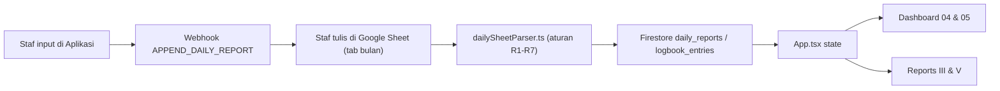

<!-- markdownlint-disable -->
# PRD — PERBAIKAN SINKRONISASI DAILY REPORT (APLIKASI ⇄ GOOGLE SHEET RESMI)

**PT. Riz Production Multi Kreasi** · Versi 1.0 · 5 Oktober 2026
**Wajib dibaca bersama:** `AGENTS.md` (aturan kerja permanen)

> [!IMPORTANT]
> Dokumen ini ditulis agar bisa dikerjakan agen berkemampuan rendah.
> Kerjakan **satu tugas per sesi**, **berurutan**, dan **jangan lompat**.
> Setiap tugas punya: file, perubahan persis, perintah uji, dan kriteria lulus.
> Jika kriteria lulus tidak tercapai: **BERHENTI dan laporkan output apa adanya**. Jangan mengarang.

---

## 0. TEMUAN AUDIT (FAKTA YANG SUDAH DIVERIFIKASI)

Bagian ini menjelaskan mengapa Dashboard menampilkan angka salah. Semua poin bisa dicek ulang.

| # | Temuan | Bukti |
|---|---|---|
| F1 | Angka di layar (Wahyudin 17, Mulyana 10, Heri 9, Ayong 3) berasal dari **parser di dalam aplikasi**, bukan dari script `agent_google_sheet_sync.ts`. | `src/lib/googleSheetSync.ts` fungsi `pullDailyLogFromGviz` (baris ±1003). Dipanggil otomatis saat Dashboard dibuka (`Dashboard.tsx` baris ±108). |
| F2 | Parser itu menghitung **setiap baris lanjutan** (baris yang kolom Crew-nya kosong) sebagai **laporan baru** untuk staf di atasnya. | `googleSheetSync.ts` baris ±1074–1080: `currentStaffNames` dibawa ke baris berikutnya. Sheet Oktober: blok `unyim` = baris 17–33 = **17 baris** → Wahyudin 17. Blok `kharo` = 8 + 2 baris = **10** → Mulyana 10. Blok `Heri` = 8 + 1 = **9** → Heri 9. |
| F3 | Parser itu membuat **1 entri QC untuk setiap laporan**, sehingga angka "QC Checked" selalu sama dengan "Daily Report". | `googleSheetSync.ts` baris ±1119–1145: `onSaveLogbookEntry` dipanggil untuk setiap laporan tanpa filter. |
| F4 | Hasil parser disimpan ke **Cloud Firestore** (ID berawalan `gsheet-v2-` dan `log-gsheet-v2-`). Memperbaiki parser **tidak menghapus** data salah yang sudah tersimpan. | `buildDedupKey` baris ±977. |
| F5 | Pencocokan nama bertabrakan: `"Udin Saepudin"` cocok ke **Aep Saepudin dan Udin**; `"unying"` cocok ke **Wahyu (Owner) dan Wahyudin**. | Diuji dengan `isStaffMatch` (`src/utils/kpiCalculator.ts`). Penyebab pasti "Aep Saepudin 17" **belum terverifikasi** — wajib diuji di Tugas T3. |
| F6 | Jalur tulis Aplikasi → Sheet membaca kunci `localStorage` **lama** (`riz_daily_reports`, `riz_logbook_entries`), padahal aplikasi menyimpan di `riz_daily_reports_v2` / `riz_logbook_entries_v2`. Data yang dikirim ke Sheet bukan data terbaru. | `googleSheetSync.ts` baris 161–162 vs `App.tsx` baris ±483–503. |
| F7 | Jalur tulis Aplikasi → Sheet menulis ke tab terpisah (`DAILY_LOGS`, dll.), **bukan** ke tab bulanan resmi (mis. tab Oktober 2026, gid `938476420`) dengan format kolom resmi. | Apps Script template `writeDailyLogsSheet`, `googleSheetSync.ts` baris ±444+. |
| F8 | `canonicalFirestoreData.ts` saat ini memuat **duplikat Oktober** (contoh: entri "Irfan" dan "Muhamad Irvan" untuk kegiatan yang sama, ID berbeda) dan entri QC lama dari aturan keyword lama. Ini akibat perbaikan sebelumnya yang memakai merge-by-ID. | Total Oktober di file: 23 laporan, padahal Sheet hanya memuat 12 baris berawak + aktivitas. |

> [!WARNING]
> Laporan agen sebelumnya yang menyatakan "angka di layar adalah data September" **SALAH dan tidak diverifikasi**. Angka di layar adalah data Oktober yang salah hitung (F1–F3).

---

## 1. TUJUAN PRODUK

1. **Google Sheet resmi adalah sumber kebenaran tunggal** untuk Daily Report.
2. **Arah A — Sheet → Aplikasi:** Staf yang menulis langsung di Google Sheet → data tampil benar di aplikasi.
3. **Arah B — Aplikasi → Sheet:** Staf yang menginput dari aplikasi → baris baru tertulis di **tab bulan berjalan** Google Sheet resmi, dengan format kolom yang sama seperti input manual.
4. Satu kegiatan hanya tercatat **satu kali**, dari arah mana pun ia masuk.
5. Berlaku untuk **setiap bulan**, bukan hanya Oktober.

## 2. DI LUAR CAKUPAN (JANGAN DIKERJAKAN)

- Mengubah tampilan/UI (tambah/hapus kolom, tombol, warna). Dilarang tanpa persetujuan user (`AGENTS.md` prinsip 5).
- Mengubah rumus bobot KPI.
- Menghapus data bulan September atau bulan lain.

---

## 3. FORMAT SUMBER RESMI (KONTRAK DATA)

Tab bulanan Google Sheet memiliki 7 kolom:

| Kolom | Nama | Isi |
|---|---|---|
| A | Tanggal | Contoh `1 Oktober 2026`, `03 oktober 2026`. Boleh kosong = ikut tanggal baris atas. |
| B | Crew | Nama/panggilan staf. Boleh lebih dari satu (dipisah baris baru, koma, `/`). Boleh diawali `- `. |
| C | SOUND | Aktivitas divisi Audio |
| D | LIGHTING | Aktivitas divisi Lighting |
| E | LED | Aktivitas divisi Videotron |
| F | MULTIMEDIA | Aktivitas divisi Multimedia |
| G | REMARK | Kondisi / catatan |

**Aturan baca (WAJIB, kecuali user memutuskan lain di Bagian 4):**

- **R1 — Entri:** Satu **entri laporan** = satu baris yang kolom **Crew terisi** DAN salah satu kolom C–F terisi.
- **R2 — Baris lanjutan:** Baris yang Crew-nya **kosong** tetapi kolom C–F atau G terisi = **detail/rincian** dari entri di atasnya. Teksnya **digabung** ke `activity`/`notes` entri tersebut, **bukan** laporan baru.
- **R3 — Tanggal:** Tanggal kosong = ikut tanggal terakhir. Parsing mendukung 12 bulan Indonesia & Inggris, huruf besar/kecil, angka berawalan nol.
- **R4 — Multi crew:** Jika satu sel Crew berisi 2 orang, setiap orang mendapat 1 entri.
- **R5 — Nama:** Panggilan dipetakan ke nama resmi memakai **satu** tabel pemetaan (Bagian 5, T2). Jika nama tidak dikenal: simpan apa adanya, tandai `_unmatched: true`, **jangan** ditebak.
- **R6 — QC:** Entri dihitung QC **hanya** jika `activity` mengandung kata: `qc`, `inspeksi`, `checklist`, `onhouse`, `p2h` (sesuai `AGENTS.md` §6.5).
- **R7 — ID stabil:** `rep-YYYYMMDD-<staffId>-<nomorBarisSheet>`. Contoh: `rep-20261002-staff-unyin-17`.

### 3.1 Angka acuan Oktober 2026 (untuk uji penerimaan)

Dihitung manual dari `official_data.md` (hasil unduh tab gid `938476420`) dengan aturan R1–R7:

| Staf resmi | Entri (Daily Report) | Hari unik | Tanggal |
|---|---:|---:|---|
| Muhamad Irvan | 2 | 2 | 1, 2 Okt |
| Ayong Sumarsih | 2 | 2 | 1, 2 Okt |
| Mulyana | 2 | 2 | 2, 3 Okt |
| Heri | 2 | 2 | 3, 4 Okt |
| Wahyudin | 1 | 1 | 2 Okt |
| Dedi Agus Wigiantoro | 1 | 1 | 2 Okt |
| Ramdani | 1 | 1 | 4 Okt |
| **Total** | **11** | | |

- QC Checked Oktober (aturan R6): **0** untuk semua staf.
- Aep Saepudin, Gatot, Udin, dll.: **tidak muncul** di tabel Oktober.

> [!NOTE]
> Angka ini berlaku untuk isi Sheet per 5 Okt 2026. Jika staf menambah baris di Sheet, angka acuan berubah — hitung ulang dengan aturan yang sama.

---

## 4. KEPUTUSAN USER YANG DIBUTUHKAN SEBELUM MULAI

Agen **tidak boleh** memutuskan sendiri. Tanyakan ke user, catat jawabannya di sini:

| ID | Pertanyaan | Opsi | Jawaban user |
|---|---|---|---|
| K1 | Baris lanjutan (Crew kosong) dihitung sebagai? | (a) Rincian entri di atasnya — **rekomendasi** (b) Laporan terpisah | (b) Laporan terpisah (setiap baris dihitung sebagai laporan baru) |
| K2 | Baris 48 `unying` (Crew terisi, aktivitas kosong, tanggal 4 Okt) dihitung? | (a) Tidak dihitung (b) Dihitung hadir tanpa laporan (c) Ikut aktivitas baris atas (Dani) | (c) Ikut aktivitas baris atas (Dani) |
| K3 | Apakah "Cek …" / "Cleaning …" dihitung QC? | (a) Tidak, hanya keyword R6 — sesuai AGENTS.md (b) Ya, tambah keyword `cek`, `cleaning` | (b) Ya, tambah keyword `cek`, `cleaning` |
| K4 | Boleh menghapus dokumen Firestore Oktober yang salah (ID `gsheet-v2-2026-10-*` dan `log-gsheet-v2-2026-10-*`)? | (a) Ya (b) Tidak, hanya disembunyikan | (a) Ya |
| K5 | Arah B menulis ke tab bulan berjalan dengan format 7 kolom resmi? | (a) Ya (b) Tetap ke tab `DAILY_LOGS` terpisah | (a) Ya |

---

## 5. DAFTAR TUGAS (KERJAKAN BERURUTAN)

Format setiap tugas: **File → Ubah apa → Uji → Lulus jika**.

### T0 — Siapkan lingkungan
- **Perintah:** `export PATH="$HOME/.node/bin:$PATH" && node -v && npm -v`
- **Lulus jika:** keluar versi Node (mis. `v20.18.0`) dan npm. Jika `command not found`: berhenti, laporkan.

### T1 — Buat satu modul parser bersama (sumber tunggal aturan baca)
- **File baru:** `src/lib/dailySheetParser.ts`
- **Isi:** fungsi murni (tanpa fetch, tanpa localStorage, tanpa Firestore):
  ```ts
  export interface SheetRow { rowNumber: number; cells: string[] } // 7 sel: A..G
  export interface ParsedEntry {
    id: string; date: string; staffName: string; staffId: string | null;
    division: 'Audio'|'Lighting'|'Videotron'|'Multimedia'|'Umum';
    activity: string; notes: string; isQc: boolean; sheetRow: number;
    _unmatched?: boolean;
  }
  export function parseIndonesianDate(raw: string): string | null;
  export function parseDailySheet(rows: SheetRow[]): ParsedEntry[];
  ```
- **Aturan:** implementasikan R1–R7 dari Bagian 3, sesuai jawaban K1–K3.
- **Dilarang:** memakai `isStaffMatch` untuk pemetaan nama (sumber tabrakan F5). Pakai tabel di T2.
- **Uji:** belum ada (diuji di T4).
- **Lulus jika:** `npm run lint` tanpa error baru.

### T2 — Satu tabel pemetaan nama (exact match, bukan substring)
- **File:** `src/lib/dailySheetParser.ts` (di file yang sama)
- **Isi:** objek `NAME_TO_STAFF_ID` berisi panggilan **huruf kecil, persis** → ID resmi dari `AGENTS.md` §2. Contoh:
  ```ts
  'irfan':'staff-irvan', 'irvan':'staff-irvan', 'ayong':'staff-ayong',
  'kharo':'staff-mulyana', 'karo':'staff-mulyana', 'mulyana':'staff-mulyana',
  'unyim':'staff-unyin', 'unyin':'staff-unyin', 'unying':'staff-unyin', 'wahyudin':'staff-unyin',
  'wigi':'staff-dedi', 'dani':'staff-ramdani', 'ramdani':'staff-ramdani',
  'heri':'staff-heri', 'mboh':'staff-rahmat', 'butonk':'staff-iwan', 'butong':'staff-iwan',
  'buluk':'staff-suryana', 'bulux':'staff-suryana', 'nana':'staff-suryana',
  'opik':'staff-taufik', 'yudis':'staff-yudish', 'yudish':'staff-yudish',
  'jay':'staff-mulyadi', 'damri':'staff-damri', 'gatot':'staff-gatot',
  'mang ube':'staff-udin', 'ube':'staff-udin', 'aep':'staff-absobur', 'subur':'staff-absobur'
  ```
- **Normalisasi sebelum lookup:** hapus awalan `- `, trim, huruf kecil, hapus spasi ganda.
- **Lulus jika:** `'unying'` → hanya `staff-unyin`; `'wahyu'` → **tidak** dipetakan ke Wahyudin.

### T3 — Uji penyebab "Aep Saepudin 17"
- **Perintah:** jalankan `isStaffMatch` untuk setiap `staffName` unik bulan Oktober di Firestore/`canonicalFirestoreData.ts`, cetak staf mana yang cocok.
- **Lulus jika:** penyebab tertulis di laporan dengan bukti output. Jangan memperbaiki apa pun di tugas ini.

### T4 — Test otomatis parser terhadap angka acuan
- **File baru:** `scripts/test_daily_sheet_parser.ts`
- **Isi:** baca `official_data.md`, ubah tabelnya menjadi `SheetRow[]` (nomor baris = urutan baris data mulai 6 sesuai file), panggil `parseDailySheet`, hitung per staf, bandingkan dengan tabel 3.1.
- **Daftarkan** di `package.json` → `test:all` (tambahkan `npx tsx scripts/test_daily_sheet_parser.ts &&` di depan `npm run build`).
- **Uji:** `npx tsx scripts/test_daily_sheet_parser.ts`
- **Lulus jika:** semua angka sama persis dengan tabel 3.1 (sesuaikan jika jawaban K1–K3 berbeda dari rekomendasi). Exit code 0.

### T5 — Pakai parser bersama di aplikasi (Arah A)
- **File:** `src/lib/googleSheetSync.ts`, fungsi `pullDailyLogFromGviz`
- **Ubah:** ganti loop baris (±1050–1269) menjadi: ubah `rows` gviz → `SheetRow[]` → `parseDailySheet()` → simpan.
  - `onSaveDailyReport(entry.id, …)` untuk setiap entri.
  - `onSaveLogbookEntry` **hanya** jika `entry.isQc === true`.
  - Temuan (`onSaveFinding`) tetap memakai `isFindingRemark` tetapi **hanya dari kolom REMARK entri**, satu temuan per entri.
- **Dilarang:** mengubah tampilan, mengubah tanda tangan fungsi (parameter tetap sama).
- **Lulus jika:** `npm run test:all` lulus.

### T6 — Pakai parser bersama di script CLI
- **File:** `scripts/agent_google_sheet_sync.ts`
- **Ubah:** ganti logika parsing internal (tanggal, crew, aktivitas) dengan `parseDailySheet()`.
- **Ubah merge:** untuk bulan yang di-sync, **ganti seluruh** entri `_source === 'google_sheet'` bulan tersebut dengan hasil parse baru (month-scoped replace). Entri bulan lain dan entri `_source` lain **tidak disentuh**. Findings & Work Orders **tidak disentuh** (`AGENTS.md` §6.2).
- **Uji:** `npm run sync:gsheet` lalu hitung entri Oktober di `canonicalFirestoreData.ts`.
- **Lulus jika:** jumlah laporan Oktober `_source: google_sheet` = **11** (atau sesuai K1/K2). Jumlah laporan September **tidak berubah** dibanding sebelum T6 (catat angkanya sebelum mulai).

### T7 — Bersihkan data Oktober yang salah di Firestore (HANYA jika K4 = Ya)
- **File baru:** `scripts/cleanup_october_gsheet_v2.ts`
- **Isi:** hapus dokumen di koleksi `daily_reports` dan `logbook_entries` yang ID-nya berawalan `gsheet-v2-2026-10-` atau `log-gsheet-v2-2026-10-`. **Mode kering dulu:** cetak daftar ID tanpa menghapus. Hapus hanya jika dijalankan dengan argumen `--confirm`.
- **Uji:** jalankan tanpa `--confirm`, kirim daftar ID ke user, tunggu persetujuan, baru jalankan dengan `--confirm`.
- **Lulus jika:** jumlah yang dihapus = jumlah di mode kering. Koleksi `findings` dan `work_orders` tidak tersentuh.

### T8 — Perbaiki kunci baca jalur tulis (Arah B, bagian 1)
- **File:** `src/lib/googleSheetSync.ts`, fungsi `getExportPayloadForGoogleSheet` baris 161–162, 168–169, 174
- **Ubah:** `'riz_logbook_entries'` → `'riz_logbook_entries_v2'`, `'riz_daily_reports'` → `'riz_daily_reports_v2'`, `'riz_findings'` → `'riz_findings_v2'`, `'riz_work_orders'` → `'riz_work_orders_v2'`, `'riz_daily_tasks'` → `'riz_daily_tasks_v2'`.
- **Lulus jika:** `npm run test:all` lulus.

### T9 — Tulis input aplikasi ke tab bulan resmi (Arah B, bagian 2 — HANYA jika K5 = a)
- **Aplikasi:** saat staf menyimpan Daily Report dari aplikasi, kirim `POST` ke webhook dengan:
  ```json
  { "action": "APPEND_DAILY_REPORT", "gid": "<gid bulan dari getGidForMonth>",
    "row": ["<d MMMM yyyy>", "<panggilan staf>", "<SOUND>", "<LIGHTING>", "<LED>", "<MULTIMEDIA>", "<REMARK>"],
    "appId": "<id laporan aplikasi>" }
  ```
  Aktivitas ditaruh di kolom sesuai divisi staf; kolom lain kosong.
- **Apps Script** (`GOOGLE_APPS_SCRIPT_TEMPLATE`): tambah cabang `APPEND_DAILY_REPORT` → cari sheet dengan `getSheetId() == gid` → `appendRow(row)` → tulis `appId` di kolom H (kolom penanda, di luar 7 kolom resmi) agar tidak terhitung dua kali.
- **Anti-duplikasi:** saat Arah A membaca Sheet, baris dengan kolom H terisi memakai `appId` itu sebagai ID entri (bukan ID buatan R7). Dengan begitu laporan dari aplikasi dan hasil baca Sheet adalah **dokumen yang sama**.
- **Catatan user:** setelah Apps Script diubah, user harus **Deploy ulang** Web App (Deploy → Manage deployments → Edit → New version). Agen tidak bisa melakukan ini.
- **Lulus jika:** satu laporan uji dari aplikasi muncul tepat **1 baris** di tab bulan berjalan, dan setelah tarik ulang (Arah A) Dashboard menghitungnya **1 kali**.

### T10 — Bulan baru otomatis
- **File:** `src/lib/googleSheetSync.ts` fungsi `getGidForMonth`
- **Ubah:** tambahkan gid bulan baru **hanya** dari user. Jika bulan aktif tidak punya gid: tampilkan pesan "GID tab bulan ini belum didaftarkan", **jangan** fallback diam-diam ke Oktober.
- **Lulus jika:** memilih bulan tanpa gid tidak menarik data bulan lain.

### T11 — Verifikasi akhir & pembaruan memori
- **Perintah:** `npm run test:all`
- **Verifikasi tampilan:** buka aplikasi, pilih **Oktober 2026**, bandingkan tabel "04. Produktivitas Staff" dengan tabel 3.1. Ambil screenshot.
- **Perbarui `AGENTS.md` §6:** catat file `dailySheetParser.ts` sebagai satu-satunya tempat aturan baca Sheet.
- **Lulus jika:** test 100% lulus **dan** angka di layar sama dengan tabel 3.1. Jika layar berbeda dari test: laporkan keduanya, jangan klaim selesai.

---

## 6. ATURAN PELAPORAN UNTUK AGEN

Setiap akhir tugas, laporkan **hanya** dengan format ini:

```
TUGAS: T<n>
FILE DIUBAH: <daftar>
PERINTAH DIJALANKAN: <perintah>
OUTPUT: <tempel output relevan, apa adanya>
STATUS: LULUS / GAGAL
CATATAN: <hal yang belum diverifikasi>
```

Dilarang:
- Menyatakan "100% data riil" tanpa membandingkan dengan tabel 3.1.
- Menjelaskan perbedaan angka dengan dugaan ("mungkin cache", "mungkin bulan lain") tanpa bukti output.
- Menyatakan selesai jika `npm run test:all` lulus tetapi tampilan di layar belum dicek.

---

## 7. DIAGRAM ALUR TARGET


